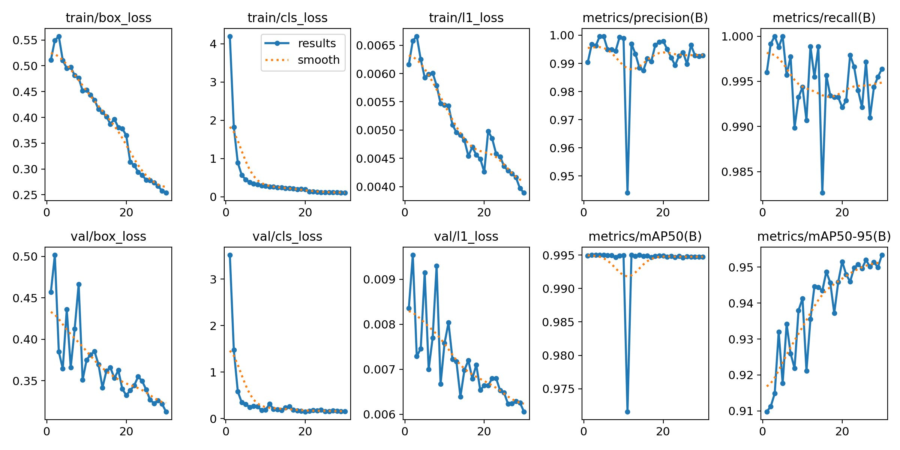
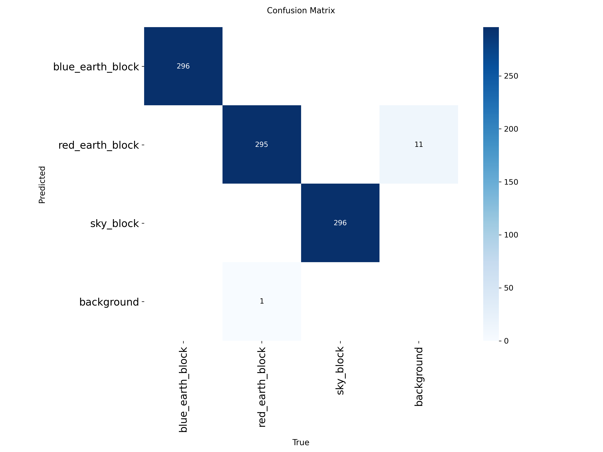
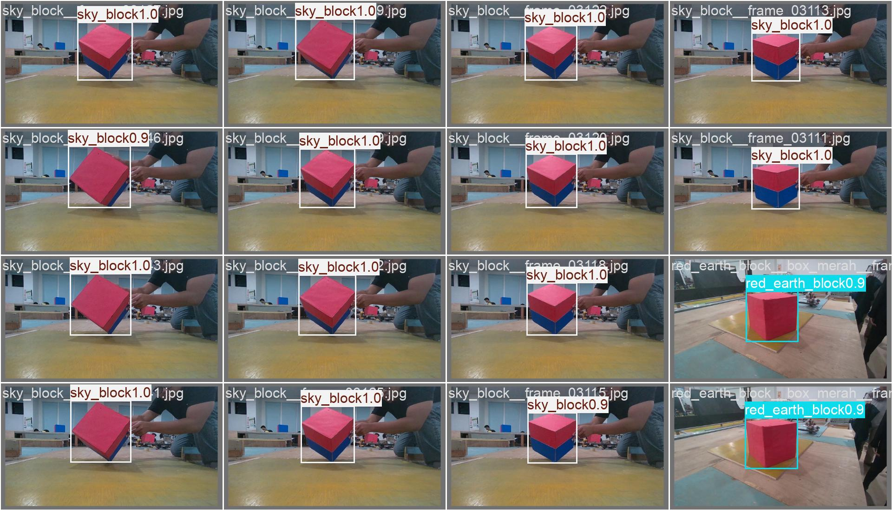

# PJ1 — Object Detection dengan YOLO

Proyek ini mengerjakan alur deteksi objek: menyiapkan anotasi bounding box, membagi dataset, melatih model, membandingkan eksperimen, lalu menguji model terpilih.

**Nama:** Athaillah Akmal

**NIM:** 4222401044

## Kelas objek

Dataset memiliki tiga kelas: `red_earth_block`, `blue_earth_block`, dan `sky_block`. Dataset gambar dan salinan split disimpan lokal dan tidak dimasukkan ke Git. Skrip pemrosesan dan konfigurasi tetap tersedia di repository.

## Alur pengerjaan

1. `00_ambil_subset_coco.py` mengambil subset data COCO.
2. `01_cek_anotasi.py`, `02_yolo_ke_coco.py`, dan `03_coco_ke_yolo.py` memeriksa serta mengonversi anotasi.
3. `05_split_dataset_yolo.py` membagi data ke train, validation, dan test dalam format YOLO.
4. `06_latih_bandingkan.py` menjalankan tiga eksperimen dengan konfigurasi dasar yang sama:
   - **E1 — pretrained:** baseline menggunakan bobot pretrained COCO.
   - **E2 — scratch:** model dilatih dari bobot acak tanpa transfer learning.
   - **E3 — tuning:** baseline pretrained dengan ukuran gambar dinaikkan menjadi 640.

## Ringkasan hasil

Model E3 memperoleh mAP50-95 validation tertinggi (0,953), sehingga dipilih untuk pengujian akhir. Pada test set, model terpilih memperoleh mAP50 0,995 dan mAP50-95 0,941. Rincian metrik ada di [`hasil_praktik_4222401044.txt`](hasil_praktik_4222401044.txt) dan [`hasil_praktik_4222401044.csv`](hasil_praktik_4222401044.csv).

### Kurva hasil E3

### Confusion matrix E3

### Contoh prediksi pada validation set

Grafik, confusion matrix, dan contoh prediksi dari ketiga eksperimen tersedia di [`hasil_praktik/`](hasil_praktik/). Checkpoint `.pt` tidak disertakan; model dapat dilatih ulang menggunakan skrip di atas dan dataset lokal.
